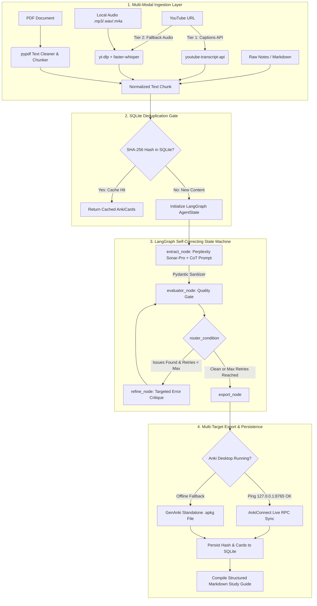

# 🧠 Omnivore-to-Anki (AutoAnki Core)

[](https://www.python.org/downloads/)
[](https://github.com/astral-sh/uv)
[](https://langchain-ai.github.io/langgraph/)
[](https://modelcontextprotocol.io/)
[](https://docs.perplexity.ai/)
[](https://github.com/astral-sh/ruff)

**Omnivore-to-Anki** is an autonomous, multi-source AI ingestion pipeline that transforms messy technical inputs—such as YouTube lectures, multi-page PDF reports, local audio recordings, or raw engineering notes—into verified, atomic spaced-repetition Anki decks (`.apkg` & live `AnkiConnect` sync) and structured Markdown study guides.

Built as a production-grade showcase across **four core AI engineering pillars**:
1. **Advanced Prompt Engineering:** Multi-stage Chain-of-Thought (CoT) extraction bound to strict Pydantic schemas enforcing Piotr Woźniak's *Minimum Information Principle*.
2. **APIs & Model Context Protocol (MCP):** Full `FastMCP` server implementation, OpenAI-compatible Perplexity `sonar-pro` integration, two-tier YouTube transcript/audio ingestion (`youtube-transcript-api` + `yt-dlp` + local CTranslate2 `faster-whisper`), and live `AnkiConnect` RPC synchronization.
3. **Database Management & Deduplication:** Relational SQLAlchemy 2.0 + SQLite persistence layer utilizing deterministic SHA-256 content hashing to prevent duplicate LLM token consumption and maintain a full audit trail from source chunk to generated flashcard.
4. **Agentic Automation:** Self-correcting state machine orchestrated via **LangGraph** that audits every drafted card against deterministic and semantic quality gates (atomicity, answer leakage, cloze syntax) and autonomously loops back for targeted refinement before export.

---

## 🏗️ System Architecture

### End-to-End Ingestion & Agentic Self-Correction Pipeline



---

## 🔬 Deep Dive: The Four AI Pillars

### 1. Prompt Engineering & Cognitive Science Alignment
Standard LLM flashcard generators often produce bloated, multi-part questions that fail during spaced-repetition review months later. `AutoAnki-Core` enforces cognitive science rules at the schema level:
* **Grounded Chain-of-Thought (`ExtractionStep`):** Before drafting a single card, the model must extract a verbatim `source_quote`, distill a declarative `core_assertion`, and justify `why_retrieval_matters`.
* **Self-Evaluative Schema (`CardEvaluation`):** Every `AnkiCard` contains mandatory `is_atomic` and `has_leakage` audit booleans alongside hierarchical tag arrays (`systems::db::postgres`).
* **Reasoning Sanitizer:** A custom parser (`parse_perplexity_output`) strips `<think>...</think>` blocks from reasoning models (`sonar-reasoning-pro`) and validates output against `DeckGenerationBatch`.

### 2. APIs, Local STT & Model Context Protocol (MCP)
* **Two-Tier YouTube & Audio Processing:** Attempts zero-cost instant caption retrieval via `youtube-transcript-api`. If captions are disabled, it automatically downloads the audio stream via `yt-dlp` and transcribes it locally on CPU/GPU using `faster-whisper` (`int8` quantization with Voice Activity Detection).
* **FastMCP Tool Server:** Exposes `extract_media_transcript`, `generate_anki_deck_from_source`, and `check_anki_desktop_status` over stdio/SSE so external AI clients (Claude Desktop, Cursor, custom agents) can trigger deck creation natively.

### 3. SQLite Relational Storage & Content Deduplication
* **Zero Duplicate Token Spend:** Every normalized text chunk is hashed via SHA-256 (`StorageRepository.compute_hash`) and checked against `processed_chunks` in `data/omnivore.db` before invoking the LLM.
* **Relational Lineage:** Tracks one-to-many relationships across `SourceDocument` $\rightarrow$ `ProcessedChunk` $\rightarrow$ `StoredCard`.

### 4. LangGraph Self-Correcting Quality Loop
The `evaluator_node` combines schema inspection with deterministic heuristics:
* Flags compound questions containing conjunctions (`and`, `as well as`) paired with multi-clause answers (`atomicity_violation`).
* Flags prompts that leak target vocabulary (`answer_leakage`).
* Verifies valid `{{c1::...}}` deletion syntax on all `cloze` cards (`syntax_error`).
* Routes rejected cards to `refine_node` with structured critique strings until all cards pass or `max_retries` is reached.

---

## 📂 Repository Structure

```text
omnivore-to-anki/
├── .env.example                 # Environment variable template (Perplexity, Whisper, SQLite)
├── .gitignore                   # Ignores local DBs, cached audio, and .apkg artifacts
├── pyproject.toml               # uv dependency management and project metadata
├── README.md                    # Documentation and architecture overview
│
├── config/
│   ├── settings.py              # Pydantic BaseSettings environment loader
│   └── prompts/
│       └── system_prompt.txt    # Production CoT extraction & Wozniak rules prompt
│
├── data/                        # Local SQLite database and generated outputs (gitignored)
│   ├── cache/                   # Generated .apkg decks and *_notes.md study guides
│   └── omnivore.db              # SQLite deduplication & card lineage database
│
├── src/
│   ├── core/
│   │   ├── exceptions.py        # Domain exceptions (IngestionError, ValidationError, SyncError)
│   │   └── schemas.py           # Pydantic models (DeckGenerationBatch, AnkiCard, ExtractionStep)
│   ├── ingestion/
│   │   ├── base.py              # Abstract BaseSourceLoader interface
│   │   ├── audio.py             # CTranslate2 faster-whisper local audio transcriber
│   │   ├── pdf.py               # pypdf text extractor, cleaner, and overlapping chunker
│   │   └── youtube.py           # Two-tier YouTube transcript & yt-dlp audio fallback
│   ├── storage/
│   │   ├── connection.py        # SQLAlchemy 2.0 engine and transactional session context
│   │   ├── models.py            # ORM tables (SourceDocument, ProcessedChunk, StoredCard)
│   │   └── repository.py        # SHA-256 deduplication queries and card CRUD operations
│   ├── agents/
│   │   ├── state.py             # LangGraph AgentState and QualityIssue TypedDicts
│   │   ├── graph.py             # Compiled StateGraph with Perplexity Sonar integration
│   │   └── nodes/               # Modular node wrappers (extractor, evaluator, router)
│   ├── mcp/
│   │   ├── server.py            # FastMCP server exposing pipeline tools
│   │   └── tools/
│   │       ├── anki_connect.py  # Async httpx client for AnkiConnect (port 8765)
│   │       └── transcript.py    # Unified router for URLs, PDFs, audio, and text files
│   └── export/
│       ├── anki_package.py      # Standalone .apkg compiler using genanki
│       └── markdown.py          # Structured Markdown study guide generator
│
├── scripts/
│   ├── run_pipeline.py          # End-to-end CLI runner
│   └── run_mcp_server.py        # Entrypoint for FastMCP stdio server
│
└── tests/                       # Pytest suite (schemas, ingestion, LangGraph loop, exports)
```

---

## 🚀 Getting Started

### Prerequisites
* **Python 3.11+**
* **[uv](https://github.com/astral-sh/uv)** (fast Python package and environment manager)
* **Perplexity API Key** (`PERPLEXITY_API_KEY`)
* *(Optional)* **[Anki Desktop](https://apps.ankiweb.net/)** with the **[AnkiConnect](https://foosoft.net/projects/anki-connect/)** add-on (code `2055492159`) for live synchronization. If Anki Desktop is closed, the pipeline automatically falls back to generating standalone `.apkg` files.

### 1. Automated Setup (Windows PowerShell)
Run the included PowerShell initialization script to scaffold the directory tree and install all dependencies via `uv`:

```powershell
Set-ExecutionPolicy -Scope Process -ExecutionPolicy Bypass
.\init_project-v2.ps1
cd omnivore-to-anki
```

### 2. Configure Environment Variables
Copy `.env.example` to `.env` and add your Perplexity API key:

```powershell
Copy-Item .env.example .env
```

Edit `.env`:
```env
PERPLEXITY_API_KEY=pplx-xxxxxxxxxxxxxxxxxxxxxxxxxxxxxxxxxxxxxxxx
PERPLEXITY_MODEL=sonar-pro
WHISPER_MODEL_SIZE=base
WHISPER_DEVICE=cpu
ANKI_CONNECT_URL=http://127.0.0.1:8765
DATABASE_URL=sqlite:///./data/omnivore.db
LOG_LEVEL=INFO
```

---

## 💻 Usage Examples

### 1. Run with Default Technical Snippet
```powershell
uv run python scripts/run_pipeline.py
```

### 2. Convert a YouTube Technical Lecture into an Anki Deck
```powershell
uv run python scripts/run_pipeline.py `
  --source "https://www.youtube.com/watch?v=dQw4w9WgXcQ" `
  --deck "Systems::Distributed::Consensus"
```

### 3. Convert a Local PDF Report or Paper
```powershell
uv run python scripts/run_pipeline.py `
  --source "path/to/technical_whitepaper.pdf" `
  --deck "Architecture::Whitepapers"
```

### 4. Transcribe & Convert a Local Audio Recording (`.mp3` / `.wav` / `.m4a`)
```powershell
uv run python scripts/run_pipeline.py `
  --source "path/to/lecture_recording.m4a" `
  --deck "Lectures::AudioNotes"
```

### 5. Bypass SQLite Deduplication Cache (`--force`)
If you updated `system_prompt.txt` and want to regenerate cards for a previously processed source:
```powershell
uv run python scripts/run_pipeline.py `
  --source "path/to/technical_whitepaper.pdf" `
  --deck "Architecture::Whitepapers" `
  --force
```

---

## 🔌 Model Context Protocol (MCP) Integration

Expose **Omnivore-to-Anki** directly to **Claude Desktop**, **Cursor**, or any MCP-compliant host by adding the server to your `claude_desktop_config.json` or `.cursor/mcp.json`:

```json
{
  "mcpServers": {
    "omnivore-to-anki": {
      "command": "uv",
      "args": [
        "--directory",
        "C:/absolute/path/to/omnivore-to-anki",
        "run",
        "python",
        "scripts/run_mcp_server.py"
      ],
      "env": {
        "PERPLEXITY_API_KEY": "pplx-xxxxxxxxxxxxxxxxxxxxxxxxxxxxxxxxxxxxxxxx"
      }
    }
  }
}
```

### Available MCP Tools
| Tool Name | Description |
| :--- | :--- |
| `extract_media_transcript(source)` | Extracts cleaned text from a YouTube URL, PDF path, or local audio file. |
| `generate_anki_deck_from_source(source, deck_name, max_retries)` | Executes the full LangGraph pipeline and syncs/exports the resulting Anki deck. |
| `check_anki_desktop_status()` | Pings `http://127.0.0.1:8765` to check if Anki Desktop & AnkiConnect are online. |

---

## 🧪 Testing & Code Quality

Run the unit test suite via `pytest`:

```powershell
uv run pytest -v
```

Run linting and formatting checks via `ruff`:

```powershell
uv run ruff check src/ tests/ scripts/
```

---

## 📄 License
Distributed under the MIT License.